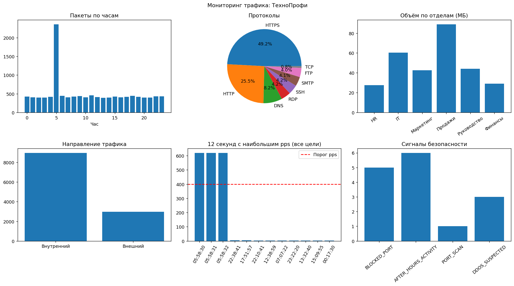

# Мониторинг сетевого трафика предприятия «ТехноПрофи»

**Домашнее задание к лекции «Обеспечение сетевого трафика предприятия», 17.11.2026.**  
Дисциплина: «Информационная безопасность бизнес-процессов».  
Объект исследования: учебная компания «ТехноПрофи» (200 сотрудников).  
Язык: Python 3.10+.

> Репозиторий содержит учебный прототип. Сетевой трафик **синтезируется**; демонстрационные атаки добавляются как строки DataFrame. Код **не генерирует DDoS-трафик** и не сканирует реальные адреса. Соединения с внешними сервисами по умолчанию выключены.

## Что реализовано

| Задание | Реализация | Где посмотреть |
|---|---|---|
| 1.1 DDoS по пакетам/с | Группировка по IP-назначению и односекундным интервалам, проверка 400 pps и минимум 15 уникальных IP-источников | `analyzer.py` → `detect_ddos()` |
| 1.2 Журнал аудита | JSONL с UTC, типом события, содержимым и хеш-цепочкой SHA-256 + функция верификации | `audit.py` |
| 1.3 Telegram/Slack | Реальные HTTP-адаптеры и безопасный демонстрационный режим, отправка только с согласия | `alerts.py` |
| 2 ROI | Модель стоимости утечки, простоя, мелких утечек, затрат и окупаемости; исходные цифры редактируются | `roi.py`, `config/roi_scenario.json` |
| 3.1 Биометрия | Адаптер передачи assertion во внешний сервис проверки личности без хранения биометрических шаблонов | `integrations.py` → `BiometricAuthAdapter` |
| 3.2 AWS/Azure | Экспорт агрегированных метрик в AWS CloudWatch и пользовательских логов в Azure Monitor | `integrations.py` → `CloudMonitorExporter` |
| 3.3 MISP/OTX | Обогащение IP из двух источников индикаторов угроз | `integrations.py` → `ThreatIntelAdapter` |

### Связь с лекцией

В лекции преподавателя в базовом классе `NetworkTrafficAnalyzer` присутствуют: генерация **10 000** синтетических событий на **24 часа**, анализ распределения протоколов/отделов, проверка заблокированных портов, активности вне рабочих часов, признаков сканирования, отчёт и четыре диаграммы. Эти идеи и наименования сохранены в адаптированной реализации. В исходной лекции был объявлен шаблон `ddos_attack` с порогом за одну минуту, но самостоятельной проверки пакетов/с не было. В домашней работе она добавлена отдельным методом с измерением `pps`.

Доработки относительно лекции: `np.random.default_rng`, тестовые адреса сетей `198.51.100.0/24` и `203.0.113.0/24`, 3 смоделированных секунды высокой нагрузки, искусственный пример сканирования, модули аудита, уведомлений, облаков/биометрии/угроз и расчёт ROI. Результат зависит от учебных параметров, **не означает доказанного факта реальной атаки**.

## Запуск прямо на GitHub (без Colab и локального Python)

1. На GitHub создайте пустой репозиторий, например `network-traffic-monitoring-homework`.
2. **Распакуйте ZIP** с домашней работой и загрузите **все файлы и папки изнутри архива** на GitHub через `Add file → Upload files` (включая `.github/workflows/`). Не загружайте сам ZIP как единственный файл.
3. Подтвердите сохранение кнопкой **Commit changes**.
4. Перейдите во вкладку **Actions**, выберите **«Проверка домашнего задания»**. Если проверка не стартовала после загрузки, нажмите **Run workflow** (при необходимости сначала разрешите Actions в настройках репозитория).
5. Откройте завершённый запуск и убедитесь, что этапы **«Проверить работу кода»** и **«Запустить все три задания»** отмечены зелёным. Внизу страницы запуска можно скачать артефакт `otchet-monitoring` с отчётами.
6. **В LMS отправляется ссылка на сам GitHub-репозиторий**, не на Colab и не на архив.

Во время выполнения GitHub Actions используются **только синтетические данные**, а внешние интеграции остаются в демонстрационном режиме. Отдельные учётные записи AWS/Azure/Telegram не нужны для проверки.

## Быстрый запуск

Из терминала внутри каталога проекта:

```bash
python -m pip install -r requirements.txt
python main.py
```

Результаты появятся в папке `results/`:

- `network_traffic_analysis.png` – диаграммы, включая пиковый pps;
- `security_report.txt` – анализ нарушений и рекомендации;
- `traffic_sample.csv` – исходный синтетический трафик (11 950 строк);
- `alerts.json` – обнаруженные сигналы;
- `audit.jsonl` – журнал с цепочкой хешей;
- `roi_report.txt`, `roi_results.json` – формулы и ROI;
- `integration_results.json` – демонстрация работы адаптеров.

Результаты **уже выполненного тестового запуска** также находятся в папке [`evidence/`](evidence/):



### Тесты

```bash
python -m unittest discover -s tests -v
```

Тесты проверяют DDoS/pps, сканирование, защиту журнала от незаметной правки, арифметику ROI и безопасный demo-режим. Тестирование не требует токенов и подключения к внешним сервисам.

## Задание 1. Обнаружение DDoS, аудит, оповещения

Для каждого `destination_ip` подсчитывается количество записей за каждую секунду:

`pps = число пакетов / 1 секунда`

Сигнал формируется, когда **pps ≥ 400** и **число уникальных IP-источников ≥ 15**. Порог выбран для учебного примера; в реальной компании его калибруют по нормальной нагрузке, расположению датчика и протоколам. Предположено, что одна запись DataFrame соответствует одному пакету. Реальному `NetFlow`/логам не всегда соответствует один пакет на одну запись, поэтому для настоящего `pps` нужны счётчики пакетов или захват пакетов.

Журнал `audit.jsonl` создаёт связанный хеш для каждого события. Проверка: `audit.verify()`. Хеш-цепочка позволяет выявлять изменения записей без пересчёта всей цепочки, но **сама по себе не соответствует ISO 27001/PCI DSS и не защищает от атакующего, способного переписать весь журнал**. В промышленной среде необходимы журналирование вне рабочей станции, ограничения доступа, WORM/immutable storage, сохранение последнего хеша в доверенном хранилище, ротация, retention и синхронизация времени. Персональные данные, токены и биометрические шаблоны в аудит не сохраняются.

В демонстрационном режиме Telegram/Slack возвращают предпросмотр сообщения, а не отправляют его. В рабочем режиме выполняется один вызов оповещения о первом DDoS-сигнале, чтобы не рассылать десятки одинаковых сообщений.

## Задание 2. Бизнес-кейс и ROI

**Внешний источник:** IBM и Ponemon Institute, *Cost of a Data Breach Report 2026*. Глобальная средняя стоимость подтверждённой утечки составляет **$4,99 млн**. Это **не** средняя стоимость *любого* инцидента и **не** персональная оценка компании на 200 сотрудников. Все остальные исходные значения ниже – **явные учебные допущения**, а не оценки IBM/Ponemon.

[Первичный источник IBM](https://www.ibm.com/reports/data-breach) · [Пресс-релиз IBM от 29.07.2026](https://newsroom.ibm.com/2026-07-29-ibm-study-one-in-four-malicious-breaches-are-ai-enabled%2C-costing-companies-6-million-on-average)

### Исходные данные (пример, доллары США)

| Показатель | До | После |
|---|---:|---:|
| Вероятность крупной утечки за год | 2,0% | 1,2% |
| Часы **обычного** простоя за год (вне крупных утечек) | 40 | 16 |
| Потери от **других мелких инцидентов** конфиденциальности, $/год | 8 000 | 4 000 |
| Ущерб от одной крупной утечки, $ | 4 990 000 | 4 990 000 |

Дополнительные допущения: цена одного часа обычного простоя **$200**, внедрение **$25 000**, обслуживание в год **$8 000**. При расчёте **не допускается двойной учёт**: стоимость крупной утечки учитывает её собственные потери; экономию обычного простоя и других мелких инцидентов рассматриваем отдельно.

### Расчёт

1. Снижение ожидаемого ущерба от крупной утечки: `(0.020 - 0.012) × 4 990 000 = $39 920`.
2. Экономия простоя: `(40 - 16) × $200 = $4 800`.
3. Экономия по другим мелким потерям данных: `$8 000 - $4 000 = $4 000`.
4. Общая ожидаемая выгода в первый год: `$39 920 + $4 800 + $4 000 = $48 720`.
5. Затраты за первый год: `$25 000 + $8 000 = $33 000`.
6. **ROI = ($48 720 - $33 000) / $33 000 × 100% = 47,64%.**
7. Availability до: `(8760-40)/8760 × 100% = 99,5434%`; после: `(8760-16)/8760 × 100% = 99,8174%`.
8. Простой срок окупаемости при равномерной годовой экономии: `25 000 / (48 720 - 8 000) × 12 ≈ 7,37 месяца`.

Это лишь **сценарная оценка**, не доказанный экономический эффект и не утверждение, что вероятность утечки реально изменится на 0,8 п.п. Для решения о внедрении нужны собственная статистика, оценка угроз, стоимость рабочего часа, вероятности и чувствительность к предположениям.

Полный машинный расчёт: [`evidence/roi_results.json`](evidence/roi_results.json) и [`evidence/roi_report.txt`](evidence/roi_report.txt). Для изменения вводных значений отредактируйте `config/roi_scenario.json` и перезапустите `python main.py`.

## Задание 3. Интеграции

### Биометрия

Адаптер использует **результат аутентификации от внешнего доверенного сервиса**: передаёт `user_id` и короткоживущий `assertion`, получает `verified`. Демо всегда возвращает `authenticated=False`, чтобы его нельзя было использовать как настоящий успешный вход. Реальное подключение возможно только при наличии сервиса, HTTPS, правильного API-контракта, сроков жизни и проверки токенов. Биометрические изображения и шаблоны проект не хранит.

### AWS и Azure

- **AWS CloudWatch**: `boto3.client('cloudwatch').put_metric_data`, метрики `DdosAlerts`, `PeakPps`, `TotalPackets`. Понадобятся `AWS_REGION`, права IAM и настроенные AWS credentials.
- **Azure Monitor**: `LogsIngestionClient.upload` c Azure DCR. Потребуются Log Analytics workspace, целевая таблица, Data Collection Rule, права Microsoft Entra и переменные `AZURE_LOG_ENDPOINT`, `AZURE_DCR_ID`, `AZURE_STREAM_NAME`.

В демо показаны только агрегированные метрики без содержимого пакетов и персональных данных.

Документация: [AWS PutMetricData](https://docs.aws.amazon.com/boto3/latest/reference/services/cloudwatch/client/put_metric_data.html) · [Azure Logs Ingestion API](https://learn.microsoft.com/en-us/azure/azure-monitor/logs/tutorial-logs-ingestion-code).

### MISP и AlienVault OTX

- **MISP**: запрос по атрибуту IP через `POST /attributes/restSearch` с API-ключом.
- **OTX**: запрос `GET /api/v1/indicators/IPv4/{ip}/general` с `X-OTX-API-KEY`.

В демонстрационном режиме пример `203.0.113.66` **искусственно** помечается индикаторами MISP/OTX. Это документальный тестовый IP, **не настоящий вредоносный адрес**. Для реального опроса принимаются только глобально маршрутизируемые IPv4. Наличие индикатора **не доказывает** злонамеренность: блокировка не выполняется.

Документация: [MISP REST API](https://github.com/MISP/MISP/blob/2.5/docs/API_Doc.md) · [AlienVault OTX](https://otx.alienvault.com/).

### Включение живых подключений (не требуется для сдачи)

По умолчанию исходящие API-запросы отключены. Для них необходимо **одновременно**:

1. Установить дополнительные библиотеки: `pip install -r requirements-integrations.txt`.
2. Скопировать `.env.example` в `.env`, добавить свои токены и адреса.
3. Изменить в `.env` `ALLOW_EXTERNAL_CALLS=1`.
4. Запустить: `python main.py --live`.

**Никогда не помещайте `.env`, API-ключи, токены Telegram или Slack webhook в GitHub.** Рабочие интеграции потребуют выданных прав и тестовой инфраструктуры. Готовность адаптера **не означает**, что реальные AWS, Azure, биометрический IdP, MISP или OTX уже подключены и прошли испытания.

## Как сдать через GitHub

### Вариант без терминала

1. Войдите на [github.com](https://github.com/) и нажмите **New repository**.
2. Название, например `network-traffic-monitoring-homework`.
3. Создайте репозиторий без автоматического README (он уже есть в проекте).
4. Нажмите **uploading an existing file** и загрузите содержимое папки проекта **вместе с вложенными папками**. Можно предварительно распаковать архив и перетащить все файлы и каталоги в окно браузера.
5. Подтвердите **Commit changes**.
6. Скопируйте URL вида `https://github.com/ВАШ_ЛОГИН/network-traffic-monitoring-homework` и вставьте **именно эту ссылку** в LMS.

### Вариант через Git

```bash
git init
git add .
git commit -m "Домашняя работа: мониторинг трафика, DDoS, ROI и интеграции"
git branch -M main
git remote add origin https://github.com/ВАШ_ЛОГИН/network-traffic-monitoring-homework.git
git push -u origin main
```

Проверьте, что на GitHub видны `README.md`, исходники, `tests/`, `config/` и `evidence/`. **Не** загружайте `.env` и личные данные.

## Что важно понимать при защите

- **DDoS**: много пакетов/с к одной цели от множества источников; порог эвристический, возможны ложные срабатывания.
- **Аудит**: запись времени, типа и деталей событий с проверкой целостности; цепочка SHA-256 не является полноценной сертификацией ISO 27001.
- **Уведомления**: Telegram/Slack получают только краткое сообщение о подозрении; в учебном запуске ничего не отправляется.
- **ROI**: процент ожидаемой чистой выгоды к вложениям за первый год, чувствителен к предположениям.
- **Интеграции**: внешние API дают сведения, публикацию метрик или результат аутентификации; демо не заменяет реально настроенный сервис.

## Структура

```text
network-traffic-monitoring/
├── main.py                      # запуск всех трёх заданий
├── analyzer.py                  # анализ трафика / DDoS / диаграммы
├── audit.py                     # журнал и проверка хеш-цепочки
├── alerts.py                    # Telegram, Slack
├── roi.py                       # финансовая модель
├── integrations.py              # биометрия, AWS, Azure, MISP, OTX
├── config/roi_scenario.json     # изменяемые допущения
├── tests/test_network.py        # автотесты
├── evidence/                    # результаты проверочного запуска
├── .github/workflows/python-checks.yml  # запуск проверок и отчётов через GitHub Actions
├── requirements.txt
├── requirements-integrations.txt
├── .env.example
└── README.md
```
